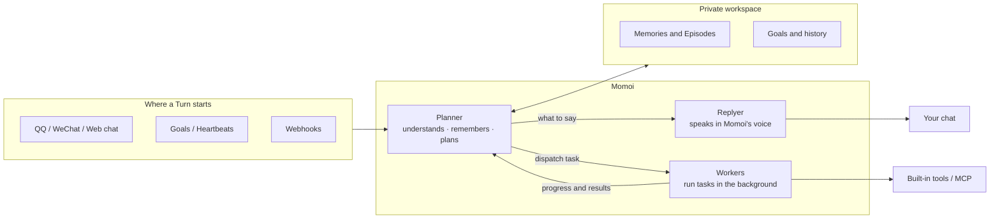
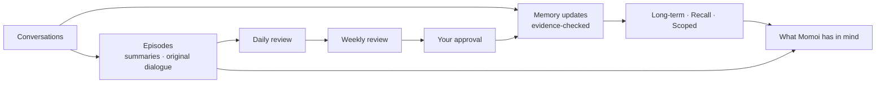

# Momoi

EN | [中文](./README.zh-CN.md)

> A personal companion agent that lives in your private chat.

Momoi chats with you on QQ and WeChat, remembers what matters, gets things done
with tools, keeps track of plans over time, and reaches out on her own when she
has something worth sharing. She works with Anthropic Messages-compatible or
OpenAI Chat Completions-compatible models and grows new abilities through MCP.

`SOUL.md` defines who Momoi is. Everything else is built to keep that person
continuous: she remembers your conversations, follows through on what she
started, and picks up where you left off — whether you message her, a
scheduled plan comes due, or an outside event arrives.

Momoi is designed for one owner on a trusted personal deployment.


## Highlights

- **One continuous companion.** Chats, plans, autonomous moments, and external
  events all share one history and one relationship.
- **Memory that grows with you.** Core facts stay in mind, details come back
  when they become relevant, and daily reflections turn repeated observations
  into memory candidates you approve.
- **Gets real work done.** Momoi hands longer tasks to background Workers that
  search, browse, run tools, and call MCP services, while she keeps talking with
  you and tells you the results when they arrive.
- **Lives in time.** Goals run once, on an interval, or several times a day.
  Heartbeats give her room to explore, create, and check in on her own.
- **Natural conversation.** Multi-bubble replies, voice messages, images, files,
  image reactions, and real-time QQ voice calls.
- **Everything stays local.** Conversations, memories, Goals, and execution
  records live in your own workspace, with a Dashboard to view and edit them.

## How it works



Each Turn has three roles:

- **Planner** is Momoi's mind. She reads the conversation and her memories,
  decides what to do, updates memories and Goals, and sends work to Workers.
- **Replyer** is Momoi's voice. Guided by `SOUL.md` and the recent dialogue, she
  turns the Planner's intent into natural messages.
- **Workers** are focused helpers. Each one receives a clear task, uses tools and
  MCP services to complete it, and reports back. A Worker report wakes the
  Planner, who decides what to tell you and what to remember.

New messages join the current Turn as you type, so you can add details or
change your mind mid-task. Use `/stop` any time to end the current work.

## Memory

| Type | What it holds |
| --- | --- |
| Long-term | Core facts and preferences Momoi always keeps in mind |
| Recall | Details that come back through keywords, semantic search, or trigger phrases |
| Scoped | Rules for a specific Goal or Webhook workflow |
| Reflection | Observations from daily and weekly reviews, waiting for your approval |

Episodes keep the stories behind the memories: topic summaries and the original
conversations, which Momoi reads when she wants to look back.

Each day Momoi reviews the conversations, writes a diary, and notes what she
learned about you. Each week she merges those notes into candidates with
supporting evidence. Candidates with enough independent evidence appear in the
Dashboard, where you can edit, approve, or remove them. A weekly check also
highlights memories that may have changed so you can keep them current.



Trigger phrases link words you naturally use to a recall memory, so the right
detail comes back the moment you mention it. Edit them in the Dashboard.

## Capabilities

| Area | What you get |
| --- | --- |
| Chat | QQ (OneBot), WeChat, and web chat with one owner; replies go back to the channel you used |
| Conversation | Message batching, quotes and forwards, media, multi-bubble replies, image reactions, and comfortable silence |
| Voice calls | Real-time QQ calls with streaming speech and interruption, via NapCat on Windows or the SnowLuma overlay on Linux |
| Speech recognition | Tencent Cloud ASR or local Sherpa streaming ASR |
| Background work | Workers with built-in tools, MCP services, progress reports, and recovery after restarts |
| Time and initiative | Goals with flexible schedules, Heartbeats, and quiet hours |
| Memory | Long-term, recall, and scoped memories, Episodes, trigger phrases, semantic search, and reflection |
| Dashboard | Conversations, decision flows, memories, Goals, reflections, token usage and cost, prompts, and settings |
| External events | Authenticated Webhooks with YAML workflows |

## Get started

### Windows desktop

Download the installer from [GitHub Releases](https://github.com/RicterZ/Momoi/releases).
It includes the backend, default prompts, and six image reactions. Configure your
model in the first-run Dashboard guide; message channels are optional, and web
chat works right away.

### Docker Compose

The published `docker-compose.yml` starts Momoi and SnowLuma. Install Docker
with Compose v2, then run:

```bash
docker compose -f docker-compose.yml up -d
docker compose -f docker-compose.yml logs momoi
```

Open `http://127.0.0.1:8788`, sign in with the Dashboard token from the logs,
and connect a model in Settings to start chatting on the web.

To add QQ, open SnowLuma at `http://127.0.0.1:6081` and scan the login code. Then
enable QQ in Momoi's Settings with the OneBot address `ws://snowluma:3001/`, your
QQ number, and the OneBot access token from the SnowLuma WebUI. Voice calls are
available through the experimental
[SnowLuma voice-call overlay](infra/snowluma-call/README.md).

The image bundles the BGE model for semantic memory. Your workspace lives in
`~/.momoi`. See [Configuration](./docs/CONFIG.md) for ports, Webhooks, and more.

### Run from source

Requirements: Python 3.12+, [uv](https://docs.astral.sh/uv/), and an Anthropic
Messages-compatible or OpenAI Chat Completions-compatible endpoint.

```bash
uv tool install .
momoi
```

Open `http://127.0.0.1:8788`, sign in with the token printed at startup, and
finish setup in Settings. Use `momoi --workspace /path/to/workspace` for another
workspace, and run `uv run --locked python packaging/prepare_embedding.py` once
to enable local semantic memory.

To build a container from the current checkout:

```bash
uv run --locked python packaging/prepare_embedding.py
uv run --locked python packaging/prepare_asr.py
docker compose -f compose.yaml up -d --build
```

## Make Momoi yours

- `~/.momoi/prompts/SOUL.md` — identity, relationship, values, interests, and voice.
- `~/.momoi/prompts/PLANNER.md` — how she understands, remembers, and plans.
  `{{SOUL}}` includes the current identity.
- `~/.momoi/prompts/REPLYER.md` — how she speaks in text and voice.
- `~/.momoi/prompts/HEARTBEAT.md` — what she explores, creates, and shares in
  her own time.
- The Dashboard emotion manager adds image reactions; each description tells
  her when the image fits.

Configure LLM, TTS, ASR, embedding, and balance services in `providers.yaml`
([Provider guide](./docs/PROVIDERS.md)). Add MCP servers in the workspace's
`mcp.json` with a clear description for each, and Workers will find the right
one for the job.

### Webhooks

Enable `webhooks`, set a bearer token, and send events to the included
`event-message` workflow:

```bash
curl -X POST http://127.0.0.1:8787/webhooks/event-message \
  -H "Authorization: Bearer $MOMOI_WEBHOOK_TOKEN" \
  -H "Content-Type: application/json" \
  --data '{"event_prompt":"The watched page changed. Explain what is new if it matters."}'
```

Momoi handles the event with her full memory and history and tells you when it
matters.

## Chat commands

| Command | Purpose |
| --- | --- |
| `/stop` | Stop the current work |
| `/compact` | Compact the active conversation context |
| `/reset-replyer` | Start the Replyer's chat context fresh |
| `/heartbeat` | Start a Heartbeat now |
| `/reflect` | Run a daily review now |

Run `momoi --help` for startup options; everything else lives in the Dashboard.

## Documentation

- [Configuration reference](./docs/CONFIG.md)
- [Webhook workflow reference](./docs/WORKFLOW.md)

Momoi is licensed under the [MIT License](./LICENSE).
