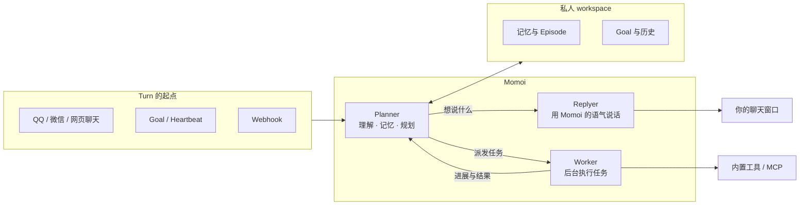
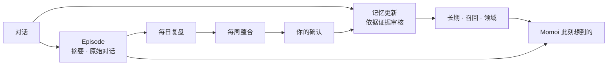

# Momoi

[EN](./README.md) | 中文

> 住在私聊里、只属于你的个人陪伴 Agent。

Momoi 在 QQ 和微信里陪你聊天，记住重要的事，用工具帮你办事，长期跟进计划，
有值得分享的东西时也会主动找你。她支持兼容 Anthropic Messages 或 OpenAI
Chat Completions 的模型，并可通过 MCP 获得新能力。

`SOUL.md` 定义 Momoi 是谁，其余部分让这个人格持续存在：她记得你们聊过什么，
把开始的事情做完，无论是你发来消息、计划到期，还是外部事件到达，都能接着上次继续。

Momoi 面向一位主人和可信的个人部署环境。

## 亮点

- **始终如一的陪伴。** 聊天、计划、自主时间和外部事件共享同一段历史、同一段关系。
- **和你一起成长的记忆。** 核心事实常记心上，细节在相关时自然想起；每日复盘把反复出现的
  观察整理成候选，由你决定是否记住。
- **真正把事情办成。** 较长的任务交给后台 Worker 去搜索、浏览、调用工具和 MCP 服务，
  Momoi 继续和你聊天，结果回来后再告诉你。
- **活在时间里。** Goal 支持单次、间隔和每日多个时间点；Heartbeat 让她在自己的时间里
  探索、创作、主动问候。
- **自然的交流。** 多气泡回复、语音消息、图片、文件、表情图片和 QQ 实时语音通话。
- **一切留在本地。** 对话、记忆、Goal 和执行记录保存在你自己的 workspace，可在 Dashboard
  中查看和编辑。

## 工作方式



每个 Turn 由三个角色协作：

- **Planner** 是 Momoi 的思考。她阅读对话和记忆，决定怎么做，更新记忆与 Goal，并把任务派给 Worker。
- **Replyer** 是 Momoi 的声音。她依据 `SOUL.md` 和近期对话，把 Planner 的意图说成自然的话。
- **Worker** 是专注的帮手。每个 Worker 接到明确的任务，用工具和 MCP 服务完成后汇报；
  汇报会唤醒 Planner，由她决定告诉你什么、记住什么。

新消息会随时并入当前 Turn，你可以在任务进行中补充细节或改变主意；随时用 `/stop` 结束当前工作。

## 记忆

| 类型 | 内容 |
| --- | --- |
| 长期 | Momoi 时刻记着的核心事实与偏好 |
| 召回 | 通过关键词、语义检索或触发词在需要时想起的细节 |
| 领域 | 适用于特定 Goal 或 Webhook 工作流的规则 |
| 复盘 | 每日与每周复盘中的观察，等待你确认 |

Episode 保存记忆背后的经历：话题摘要和原始对话，Momoi 想回顾时可以随时翻阅。

Momoi 每天复盘对话、写日记，并记下对你的新了解；每周把这些观察整合成带证据的候选。
证据充分的候选会出现在 Dashboard，你可以修改、确认或删除。每周的核对还会标出可能已经
变化的记忆，方便你保持更新。



触发词把你常说的词语和召回记忆关联起来，一提到就能想起对应细节，可在 Dashboard 中编辑。

## 当前能力

| 领域 | 你能得到 |
| --- | --- |
| 聊天渠道 | 一位主人同时使用 QQ（OneBot）、微信和网页聊天，回复回到你发起对话的渠道 |
| 对话 | 消息合并、引用与转发、媒体、多气泡回复、表情图片，以及恰到好处的沉默 |
| 语音电话 | QQ 实时通话，流式语音与打断；Windows 使用 NapCat，Linux 使用 SnowLuma 接入层 |
| 语音识别 | 腾讯云 ASR 或本地 Sherpa 流式识别 |
| 后台任务 | Worker 调用内置工具与 MCP 服务，汇报进展，重启后继续恢复 |
| 时间与主动性 | 灵活排期的 Goal、Heartbeat 和静默时段 |
| 记忆 | 长期、召回、领域记忆，Episode、触发词、语义检索与复盘 |
| Dashboard | 对话、决策流、记忆、Goal、复盘、token 用量与费用、提示词和设置 |
| 外部事件 | 带认证的 Webhook 与 YAML 工作流 |

## 快速开始

### Windows 桌面版

从 [GitHub Releases](https://github.com/RicterZ/Momoi/releases) 下载安装包，内含后端、默认提示词和
六张表情图片。首次启动后在 Dashboard 引导中配置模型即可使用网页聊天，消息渠道可稍后接入。

### Docker Compose

`docker-compose.yml` 会启动 Momoi 和 SnowLuma。安装 Docker 与 Compose v2 后运行：

```bash
docker compose -f docker-compose.yml up -d
docker compose -f docker-compose.yml logs momoi
```

打开 `http://127.0.0.1:8788`，用日志中的 Dashboard token 登录，在设置页连接模型即可开始网页聊天。

接入 QQ：打开 `http://127.0.0.1:6081` 扫码登录 SnowLuma，再到 Momoi 设置页启用 QQ，OneBot 地址填写
`ws://snowluma:3001/`，并填写主人 QQ 和 SnowLuma WebUI 中的 OneBot access token。实时电话可通过实验性的
[SnowLuma 接入层](infra/snowluma-call/README.md) 启用。

镜像内置 BGE 语义记忆模型，工作区保存在 `~/.momoi`。端口、Webhook 等选项见[配置参考](./docs/CONFIG.zh-CN.md)。

### 从源码运行

需要 Python 3.12+、[uv](https://docs.astral.sh/uv/)，以及兼容 Anthropic Messages 或 OpenAI Chat Completions 的端点。

```bash
uv tool install .
momoi
```

打开 `http://127.0.0.1:8788`，用启动输出中的口令登录，在设置页完成配置。使用
`momoi --workspace /path/to/workspace` 指定其他工作区；运行一次
`uv run --locked python packaging/prepare_embedding.py` 即可启用本地语义记忆。

从当前源码构建容器：

```bash
uv run --locked python packaging/prepare_embedding.py
uv run --locked python packaging/prepare_asr.py
docker compose -f compose.yaml up -d --build
```

## 让 Momoi 成为你的

- `~/.momoi/prompts/SOUL.md`：身份、关系、价值观、兴趣和说话方式。
- `~/.momoi/prompts/PLANNER.md`：她如何理解、记忆和规划；`{{SOUL}}` 引入当前人格。
- `~/.momoi/prompts/REPLYER.md`：她在文字和语音中的表达方式。
- `~/.momoi/prompts/HEARTBEAT.md`：她在自己的时间里探索、创作和分享什么。
- 在 Dashboard 表情管理中添加表情图片，描述会告诉她每张图适合的情境。

在 `providers.yaml` 中配置 LLM、TTS、ASR、embedding 和余额服务（[Provider 指南](./docs/PROVIDERS.zh-CN.md)）。
在 workspace 的 `mcp.json` 中添加 MCP Server 并为每个服务写清描述，Worker 会为任务找到合适的能力。

### Webhook

启用 `webhooks` 并设置 Bearer token，即可向自带的 `event-message` 工作流发送事件：

```bash
curl -X POST http://127.0.0.1:8787/webhooks/event-message \
  -H "Authorization: Bearer $MOMOI_WEBHOOK_TOKEN" \
  -H "Content-Type: application/json" \
  --data '{"event_prompt":"The watched page changed. Explain what is new if it matters."}'
```

Momoi 会带着完整的记忆和历史处理事件，在值得告诉你时联系你。

## 聊天命令

| 命令 | 用途 |
| --- | --- |
| `/stop` | 停止当前工作 |
| `/compact` | 压缩当前对话上下文 |
| `/reset-replyer` | 重新开始 Replyer 的聊天上下文 |
| `/heartbeat` | 立即开始一次 Heartbeat |
| `/reflect` | 立即进行一次每日复盘 |

启动选项见 `momoi --help`，其余配置与管理都在 Dashboard 中完成。

## 文档

- [配置参考](./docs/CONFIG.zh-CN.md)
- [Webhook 工作流参考](./docs/WORKFLOW.zh-CN.md)

Momoi 使用 [MIT License](./LICENSE)。
